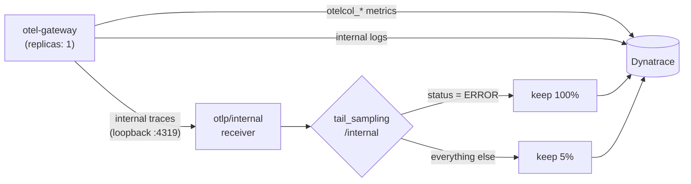

# Catalog B7 — Collector pipeline health

!!! abstract "At a glance"
    **Theme:** metrics / collector · **Time:** 25 min · **Difficulty:** medium ·
    **Skills:** `otel-collector` + `dtctl` ·
    **Reference:** `labs/advanced/catalog-b7-collector-health/`

**Goal:** make the OTel **gateway observe itself**. You ship the collector's own
`otelcol_*` metrics, its internal logs, and its internal traces (loopback
tail-sampled) to Dynatrace, then build a **pipeline-health dashboard as code**
with `dtctl`. You drive `opencode` through a prompt **ladder** — the
`otel-collector` skill to wire the self-telemetry, then the `dtctl` skill to
build the dashboard.

!!! note "Prerequisites"
    Builds on [Step 7 — Tail sampling](step-7-tail-sampling.md) (the loopback
    internal-traces pipeline reuses the same tail-sampling pattern and the
    `replicas: 1` single-instance constraint) and
    [Catalog C1](catalog-c1-dtctl-dashboard.md) (the `dtctl`
    dashboard-as-code flow — reuse that prompt ladder for ⑤).

## The concept



## ① Problem — the pipeline is a black box

A collector that silently drops spans is worse than no collector: you trust a
signal that is quietly **incomplete**. Today the training gateway only sets
`telemetry.logs.level: info` and ships **none** of its own telemetry — so when
the exporter queue saturates, a receiver refuses, or a processor drops data,
nobody sees it. You cannot answer *"is my pipeline healthy?"* without making the
collector watch itself.

## ② Understand the change

The collector already produces `otelcol_*` metrics, internal logs, and internal
traces. You enable and **export all three** through the `service::telemetry`
block (reference:
`labs/advanced/catalog-b7-collector-health/telemetry-selfobs.yaml`):

- **(a) Self-metrics** — a periodic OTLP push reader at `level: detailed` sends
  `otelcol_*` (receiver accepted/refused, processor drops, exporter
  send-failures + queue size/capacity, `process_*`) to the existing
  `otlp_http/dynatrace` endpoint.
- **(b) Self-logs** — `logs.processors` batches the collector's own log stream
  over OTLP to Dynatrace.
- **(c) Self-traces (loopback tail-sampled)** — `traces.processors` exports the
  collector's internal traces by OTLP to a **second receiver on the same
  collector** (`otlp/internal`, :4319), feeding a dedicated `traces/internal`
  pipeline whose `tail_sampling` keeps every **ERROR** and samples the boring
  rest to **5%**, then ships to Dynatrace.

Self-traces loop back **instead of** going straight to Dynatrace precisely so
they pass through tail sampling — the same discipline as Step 7, scoped to the
collector itself. The internal pipeline keeps `memory_limiter` first and reuses
the app pipelines' `otlp_http/dynatrace` exporter.

| Signal | What it answers |
|---|---|
| `otelcol_exporter_send_failed_spans` | Is export failing? |
| `otelcol_exporter_queue_size` vs `_capacity` | Is the queue saturating? |
| `otelcol_receiver_refused_spans` | Is the collector shedding load? |
| `otelcol_processor_dropped_spans` | Is a processor dropping data? |
| internal ERROR logs | What failed, in the collector's own words? |
| retained error spans | Are the collector's own error traces kept (boring ~5% sampled out)? |

## ③ Drive opencode — the prompt ladder

=== "P1 · Orient (read-only)"

    ```text
    Using the otel-collector skill: read observability/collectors/gateway.yaml
    and summarize what its service::telemetry block exports today. List the
    otelcol_* self-telemetry signals (metrics, logs, traces) the collector can
    emit but currently does NOT ship. Do not change anything yet.
    ```
    **What you should see:** the agent reports that only `telemetry.logs.level:
    info` is set and that no self-telemetry is exported.
    **Review check:** it names the three signal groups (metrics / logs / traces).

=== "P2 · Core — self-metrics + self-logs"

    ```text
    Using the otel-collector skill: in observability/collectors/gateway.yaml set
    service.telemetry.metrics to level detailed with a periodic OTLP push reader
    (interval 30s) to ${env:DT_TENANT}/api/v2/otlp using Authorization: Bearer
    ${env:DT_INGEST_TOKEN}, and add service.telemetry.logs.processors with a
    batch->otlp exporter to the same endpoint. Reuse the exporter's auth contract.
    ```
    **What you should see:** `service.telemetry.metrics.readers` (periodic/otlp)
    and `service.telemetry.logs.processors` (batch/otlp), both pointed at the DT
    OTLP base with a `Bearer` header.
    **Review check:** the token header is `Bearer ${env:DT_INGEST_TOKEN}` (a
    dt0s16 platform token) — not `Api-Token`.

=== "P3 · Deepen — self-traces via loopback + tail sampling"

    ```text
    Add a second OTLP receiver otlp/internal on grpc :4319. Export the
    collector's self-traces (service.telemetry.traces) by OTLP grpc to
    http://localhost:4319. Add a dedicated pipeline traces/internal:
    [otlp/internal] -> memory_limiter, tail_sampling/internal -> otlp_http/dynatrace.
    The tail_sampling policy: status_code=ERROR keep 100%, everything else
    probabilistic 5%, decision_wait 10s.
    ```
    **What you should see:** a new receiver, a `tail_sampling/internal` processor,
    and a `traces/internal` pipeline — with `memory_limiter` first and the
    existing Dynatrace exporter reused.
    **Review check:** self-traces go to `localhost:4319` (loopback), **not**
    straight to Dynatrace; the internal pipeline is the only consumer of
    `otlp/internal` so app traces never hit the 5% sampler.

=== "P4 · Steer — validate, apply, confirm health"

    ```text
    Validate the composed gateway config with `otelcol validate`, then apply it
    with kubectl. After rollout, confirm the gateway pod is healthy and that it
    is pushing otelcol_* metrics (check the collector logs for the periodic OTLP
    metric reader starting). Do not scale the gateway beyond replicas: 1.
    ```
    **What you should see:** config validates, the pod rolls out Ready, and the
    collector logs show the self-telemetry readers starting.
    **Review check:** the gateway is still `replicas: 1` (tail sampling needs all
    spans on one instance).

## ④ Review & apply

Diff against the reference overlay and run the offline structural check, then
apply:

```bash
bash labs/advanced/catalog-b7-collector-health/verify.sh      # offline structure check
kubectl apply -f observability/collectors/gateway.yaml
```

Reference answer: `labs/advanced/catalog-b7-collector-health/telemetry-selfobs.yaml`.

Then build the **Collector pipeline health** dashboard as code — reuse the
[Catalog C1](catalog-c1-dtctl-dashboard.md) `dtctl` prompt ladder (orient →
build 24-col grid → stamp `PARTICIPANT_ID` into the `name` → `dtctl apply -f …
--dry-run` then `dtctl apply -f …`). The manual equivalent:

```bash
bash labs/advanced/catalog-b7-collector-health/dtctl-apply.sh
```

## ⑤ Verify (DQL)

Confirm the three signal groups land in Dynatrace. Final `otelcol_*` names may be
normalized by DT on ingest — confirm live and adjust if needed.

**Metrics — exporter failures, queue saturation, refusals, drops, memory:**

```dql
timeseries { failed = sum(otelcol_exporter_send_failed_spans),
             queued = avg(otelcol_exporter_queue_size),
             refused = sum(otelcol_receiver_refused_spans),
             dropped = sum(otelcol_processor_dropped_spans),
             rss = avg(otelcol_process_memory_rss) },
  from: now() - 1h
```

**Logs — collector ERROR count per minute:**

```dql
fetch logs
| filter matchesPhrase(k8s.namespace.name, "observability")
| filter loglevel == "ERROR"
| summarize count(), by: { bin(timestamp, 1m) }
```

**Spans — the collector's own traces, by status (proves errors retained, boring
~5% sampled out):**

```dql
fetch spans
| filter matchesPhrase(k8s.namespace.name, "observability")
| summarize count(), by: { request.status }
```

- **Before:** the pipeline is a black box — a dropped span or a saturated queue
  is invisible until a downstream signal goes mysteriously incomplete.
- **After:** exporter failures, queue depth, refusals, and drops are first-class,
  dashboarded signals; the collector's own ERROR traces are retained 100% while
  the boring majority is sampled to 5%.

!!! warning "If the agent gets it wrong — steer it back"
    - **Ships self-traces straight to Dynatrace:** *"self-traces must loop back to
      the `otlp/internal` receiver on `localhost:4319` so they pass through
      `tail_sampling` — do not export them directly to `otlp_http/dynatrace`."*
    - **Puts the internal receiver on the app port:** *"use a dedicated
      `otlp/internal` receiver on :4319; the app receiver stays on 4317/4318 so
      application traces never reach the 5% sampler."*
    - **Scales the gateway out:** *"tail sampling must see all spans of a trace on
      one instance — keep `replicas: 1`, or front the loopback with a
      `loadbalancing` exporter keyed on traceID (same constraint as Step 7)."*
    - **Uses the classic token header:** *"the ingest token is a dt0s16 platform
      token — use `Authorization: Bearer ${env:DT_INGEST_TOKEN}`, not
      `Api-Token`."*
    - **Drops `memory_limiter` from the internal pipeline:** *"`memory_limiter`
      must be the first processor in every pipeline, including `traces/internal`."*
    - **Invents `otelcol_*` field names:** *"only chart metrics confirmed to
      return data; DT may normalize the `otelcol_*` names on ingest — verify
      live before hardcoding them."*

## Definition of done

- [ ] `service::telemetry` exports self-metrics (`level: detailed`, periodic OTLP) **and** self-logs (batch→OTLP) to Dynatrace
- [ ] Self-traces loop back to an `otlp/internal` receiver and are tail-sampled (ERROR 100%, else 5%) in a dedicated `traces/internal` pipeline (`memory_limiter` first)
- [ ] Gateway stays `replicas: 1`; config validates and the pod rolls out Ready
- [ ] **Collector pipeline health** dashboard built on the 24-col grid, `name` includes `PARTICIPANT_ID`, deployed via `dtctl apply -f …` (`--dry-run` passes first)
- [ ] The three ⑤ DQL groups return data (live follow-up where a tenant is up)

Back to the [catalog menu](catalog.md).
