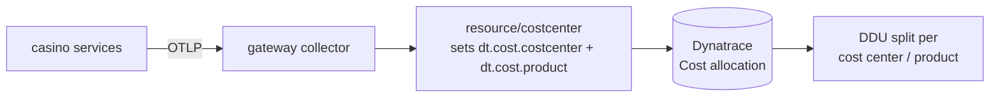

# M8 — The cost of observability

_The `labs/advanced/` directories keep their original feature-ordinal numbering, so they run one behind these doc modules — this page's assets live under `labs/advanced/step3-cost-center/`._

**Goal:** attribute your telemetry spend. You cannot manage what you cannot
attribute, so you will create a cost-center id, inject the Dynatrace
cost-center attributes at the gateway, and read ingest split per cost center.
Budget 20 minutes.

## The concept

Dynatrace **Cost Allocation** reads two **resource** attributes —
`dt.cost.costcenter` and `dt.cost.product`. Once every signal carries them,
DDU consumption can be split per team/product and charged back. Injecting at
the **gateway** (not per app) means one change covers traces, metrics, and logs
for the whole cluster. Sampling (M9) decides *how much* you ingest; the cost
center decides *who pays for it*.



## Before — one undifferentiated bucket

The baseline gateway exports telemetry with **no** `dt.cost.*` attributes, so
**Account Management → Cost allocation** shows everything under a single bucket.
You cannot answer "how much does the casino platform cost vs the scoring
service?".

## ① Create your cost-center id

Pick the id that will identify your team's ingest in the shared tenant — your
`PARTICIPANT_ID` keeps it unique in class:

```bash
export COST_CENTER_ID="casino-${PARTICIPANT_ID}"     # e.g. casino-jdoe-42
echo "$COST_CENTER_ID"
```

## ② Opencode — wire the cost center into the gateway pipeline

This is a **collector** fix, so you drive `opencode` at the gateway config with
the `otel-collector` + `otel-ottl` skills. The prompt names the **goal**, the
**target file**, and the **skills**:

```bash
opencode run "Using the otel-collector and otel-ottl skills: in \
observability/collectors/gateway.yaml add a resource/costcenter processor that upserts \
the RESOURCE attributes dt.cost.costcenter = '${env:COST_CENTER_ID}' and \
dt.cost.product = 'vegas-casino' (attributes action upsert, like \
labs/advanced/step3-cost-center/cost-center-processor.yaml). Add env var COST_CENTER_ID with \
the literal value '$COST_CENTER_ID' to the collector CR spec.env. Reference resource/costcenter \
in ALL THREE pipelines (traces, metrics, logs) right after k8sattributes — e.g. traces: \
[memory_limiter, k8sattributes, resource/costcenter]. Keep memory_limiter first; no batch processor."
```

## ③ Review — the diff should converge on

```yaml
    processors:
      resource/costcenter:
        attributes:
          - key: dt.cost.costcenter
            value: ${env:COST_CENTER_ID}     # e.g. "casino-jdoe-42"
            action: upsert
          - key: dt.cost.product
            value: vegas-casino
            action: upsert
```

```yaml
    service:
      pipelines:
        traces:  { processors: [memory_limiter, k8sattributes, resource/costcenter] }
        metrics: { processors: [memory_limiter, k8sattributes, resource/costcenter, cumulative_to_delta] }
        logs:    { processors: [memory_limiter, k8sattributes, resource/costcenter] }
```

Plus in the CR's `spec.env`:

```yaml
    env:
      - name: COST_CENTER_ID
        value: casino-<PARTICIPANT_ID>     # your id from step ①
```

!!! note "Why resource-level, and why at the gateway"
    `dt.cost.*` are **resource** attributes — they describe the source, not a
    single event, so the `resource` processor is the right tool. Putting it at
    the gateway means you tag all three signals in one place instead of touching
    every service SDK.

!!! warning "If the agent gets it wrong — steer it back"
    - **Uses the `attributes` processor or a signal-level attribute**: *"the
      cost center is a **resource** attribute — use the `resource` processor
      (or `transform` with `context: resource`), not `attributes`."*
    - **Stamps a bare `cost_center`**: *"Dynatrace Cost Allocation reads
      `dt.cost.costcenter` / `dt.cost.product` — stamp those exact keys."*
    - **Only tags traces**: *"wire `resource/costcenter` into metrics and logs
      too — allocation must cover all ingest."*
    - **Forgets the env var in `spec.env`**: *"`${env:COST_CENTER_ID}` resolves
      from the collector container env — add `COST_CENTER_ID` to `spec.env`, or
      the attribute lands empty."*
    - **Puts the processor before `k8sattributes` or moves `memory_limiter`**: *"memory_limiter
      must stay first and there is no batch processor; a resource processor goes
      after k8sattributes — move it there in every pipeline."*

## ④ Apply — validate, kubectl apply

The gateway lives in the `observability` namespace, which Argo CD does **not**
manage, so you apply it directly (collector fix — see [M5](../module-3.md)):

```bash
bash observability/validate.sh
kubectl apply -f observability/collectors/gateway.yaml
kubectl -n observability rollout status deploy/otel-gateway-collector
```

Every span, metric, and log the gateway exports now carries
`dt.cost.costcenter=casino-<PARTICIPANT_ID>` and `dt.cost.product=vegas-casino`.
The reference answer is merged into the composed
`labs/advanced/gateway-advanced.yaml` in the correct position.

## ⑤ Verify — `dt.cost.costcenter` lands on telemetry

Give it a minute (k6 keeps playing), then with your cluster filter:

```dql
fetch spans, from: now() - 15m
| filter k8s.cluster.name == "<PARTICIPANT_ID>"
| summarize spans = count() by: { dt.cost.costcenter }
| sort spans desc
```

```dql
fetch logs, from: now() - 15m
| filter k8s.cluster.name == "<PARTICIPANT_ID>"
| summarize logs = count() by: { dt.cost.costcenter }
```

```dql
fetch logs, from: now() - 1h
| filter k8s.cluster.name == "<PARTICIPANT_ID>" and isNotNull(dt.cost.costcenter)
| summarize ingested = count() by: { dt.cost.costcenter, dt.cost.product }
| sort ingested desc
```

- **Before:** `dt.cost.costcenter` is null on every record — one undifferentiated
  bucket in Account Management → Cost allocation.
- **After:** your spans **and** logs carry `dt.cost.costcenter ==
  "casino-<PARTICIPANT_ID>"` (and `dt.cost.product == "vegas-casino"`), and the
  Cost allocation view attributes your ingest to your cost center.

!!! tip "The scalable version derives the cost center from topology"
    A static env var is right when one team owns the gateway. When the gateway
    ingests for many namespaces/teams, derive the cost center per record from
    `k8s.namespace.name` / `service.name` with a `transform/costcenter` OTTL
    processor — that is the [B2 — Cost-center tagging](catalog-b2-cost-center.md)
    exercise (default-first `shared-unallocated` guard), paired with the
    [C4 — Dynatrace cost centers](catalog-c4-dynatrace-cost-center.md) showback
    dashboard.

## Definition of done

- [ ] You created a cost-center id (`casino-<PARTICIPANT_ID>`)
- [ ] The `resource/costcenter` processor is wired into all three gateway
      pipelines (after `k8sattributes`, before the exporter), with
      `COST_CENTER_ID` in the collector CR's `spec.env`
- [ ] The DQL returns rows keyed by `dt.cost.costcenter` / `dt.cost.product`
      on spans and logs
- [ ] Cost allocation in Dynatrace splits DDU per cost center

Next: [M9 — Sampling strategy](../module-4.md).
