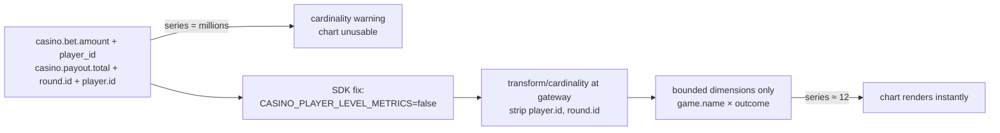

# M6 — Taming high-cardinality metrics

_The `labs/advanced/` directories keep their original feature-ordinal numbering, so they run one behind these doc modules — this page's assets live under `labs/advanced/step4-high-cardinality/`._

**Goal:** find the metrics whose cost is exploding, understand why, fix them at
the **source (SDK)** and backstop them at the **collector** — no app redeploy
needed for the backstop. Budget 40 minutes.

## The concept

Metrics are cheap *per series* and ruinous *per unbounded dimension*. One
`player_id` or `round.id` label turns a 12-series counter into millions of
series. You find the offender in Dynatrace, fix the emitting workload, then
strip the offending dimensions at the gateway so the policy holds no matter
what any workload sends.



## ① Find it — the metric that ate the tenant

The k6 load generator plays constantly with generated usernames
(`k6user_<timestamp>_<random>`). In Dynatrace, open **Metrics** and search for
`casino.bet.amount` — a histogram of amount wagered per game round, recorded by
the frontend with a `game` dimension. Now inspect its dimensions: filter or
split by **`player_id`**.

**What you should see:** `player_id` exists with a value per player — and every
k6 round mints a *new* player. A histogram's series count is
`dimensions × buckets`: unbounded `player_id` means unbounded time series. The
same story hits `casino.payout.total`, which carries `round.id` and `player.id`
(see `labs/advanced/step4-high-cardinality/before.offending-metric.md`) — every
distinct round and player is a new series. Run the load for an hour and these
metrics generate more series than the rest of the casino combined. Cardinality
is the tax you pay *before* you see any bill — it degrades queries and
dashboards first, ingest cost second (the bill itself is M8's topic).

??? question "Where does player_id come from? (click after the hunt)"
    The frontend deployment asks for it — a "per-player breakdown requested by
    analytics" — via an env var in `50-frontend.yaml`:

    ```yaml
    # Per-player metric breakdown requested by the analytics team
    - name: CASINO_PLAYER_LEVEL_METRICS
      value: "true"
    ```

    With it, `services/common/casino-metrics.js` adds `attributes.player_id =
    username` to every bet recording. The ask was reasonable; the dimension
    key was unbounded.

## ② Fix it at the source (SDK) — opencode → PR/MR on your git host

Same loop as M1/M2: drive **opencode**, review the diff, ship it through your
git host (GitLab fork default, Gitea fallback) — the casino namespace is
GitOps-owned, so no `kubectl apply` here. (Need the one-time clone? See the
[setup in M1](../module-1.md#the-fix-drive-it-with-opencode-ship-it-through-gitea).)

```bash
opencode run "Using the otel-instrumentation skill: in k8s/50-frontend.yaml, the \
vegas-casino-frontend container sets CASINO_PLAYER_LEVEL_METRICS to 'true', which \
adds an unbounded player_id dimension to casino.bet.amount. Set it to 'false'. \
Change nothing else."
```

Read the one-line diff (`value: "true"` → `value: "false"`), then ship it
(Gitea fallback: `gitea-pr.sh "fix(frontend): drop unbounded player_id metric dimension"`):

```bash
gitea-pr.sh "fix(frontend): drop unbounded player_id metric dimension"
```

**Review and merge the PR/MR in your git host's UI**; Argo CD rolls the frontend
(hit **Refresh** at `http://localhost:30002`):

```bash
kubectl -n casino rollout status deploy/vegas-casino-frontend
```

!!! warning "If the agent gets it wrong — steer it back"
    - **Flipped the wrong knob** (touched `AUDIT_LOG_VERBOSITY`): *"the only
      value to change is CASINO_PLAYER_LEVEL_METRICS, set it to false."*
    - **Deleted the env var** instead of setting it false: *"keep the env var,
      just change its value to false."*

## ③ Backstop it at the collector (control point)

The SDK fix only holds while every deployment keeps that knob `false`. A
control point makes the policy structural: the gateway drops the unbounded
dimensions no matter what workloads send.

!!! note "Collector fixes apply differently — `kubectl apply`, not the git PR loop"
    The gateway collector (`observability/collectors/gateway.yaml`) lives in the
    **training repo** and runs in the `observability` namespace, which Argo CD
    does **not** manage — so collector changes are applied with `kubectl apply`,
    not the git-host PR loop. opencode still drives the edit; only the apply step
    differs. (Same split as [M5](../module-3.md).)

Drive the edit with opencode, pointed at the collector file and the OTTL skill —
strip **both** unbounded keys (`player_id` from `casino.bet.amount`, `round.id`
/ `player.id` from `casino.payout.total`):

```bash
opencode run "Using the otel-ottl and otel-collector skills: in \
observability/collectors/gateway.yaml add a transform/cardinality processor \
(error_mode: ignore) that runs delete_key(attributes, \"player_id\") and \
delete_key(attributes, \"round.id\") on each metric datapoint, and reference it \
in the metrics pipeline after k8sattributes and before cumulative_to_delta. \
Keep memory_limiter first and do not add a batch processor."
```

The target shape — a transform processor:

```yaml
    processors:
      transform/cardinality:
        error_mode: ignore
        metric_statements:
          - context: datapoint
            statements:
              - delete_key(attributes, "player_id")
              - delete_key(attributes, "round.id")
```

referenced in the **metrics** pipeline, after enrichment and before the exporter:

```yaml
    service:
      pipelines:
        metrics:
          receivers: [otlp]
          processors: [memory_limiter, k8sattributes, transform/cardinality, cumulative_to_delta]
          exporters: [otlp_http/dynatrace]
```

*(Keep the processor list already present in your file; the point is where the
new one sits.)* Reference answer:
`labs/advanced/step4-high-cardinality/cardinality-fix-processor.yaml`.

!!! warning "If the agent gets it wrong — steer it back"
    *"only the metrics pipeline, and only delete player_id and round.id — keep
    casino.game.name and casino.outcome. memory_limiter must stay the first
    processor, there must be no batch processor, and transform/cardinality goes
    between k8sattributes and cumulative_to_delta."*

Review the diff, then apply the config-as-product discipline:

```bash
bash observability/validate.sh
kubectl apply -f observability/collectors/gateway.yaml
kubectl -n observability rollout status deploy/otel-gateway-collector
```

## Dynatrace validation checkpoint

Play a few rounds (or wait for k6), then with your cluster filter:

1. Re-check `casino.bet.amount`: new datapoints no longer carry `player_id`;
   existing split-by-player results stop gaining new series. The `game`
   dimension survives — you lost nothing you actually chart.
2. Cardinality readout on `casino.payout.total` over the last hour, in a Grail
   Notebook:

   ```dql
   timeseries cnt = count(), by: { casino.game.name, casino.outcome }, from: now() - 1h
   | fieldsAdd metric = "casino.payout.total"
   | summarize series = count()
   ```

   Or inspect the dimension cardinality directly in **Metrics → casino.payout.total
   → Dimensions**.

- **Before:** the dimension count climbs continuously (thousands → millions);
  the chart is unusable and a cardinality warning appears.
- **After:** a flat ~12 series (4 games × 3 outcomes); the chart renders
  instantly and ingest cost drops.

!!! tip "You did not lose the per-round view"
    Per-round drill-down still exists — on the **spans** from
    [M2](../module-2.md), where cardinality is free. Metrics answer "how much,
    by bounded dimension"; traces answer "what happened on this specific
    round". Use each for what it is cheap at.

!!! tip "Dig deeper"
    [M4 (Weaver)](step-3-weaver-pipeline.md) already fails the PR that *adds* a
    `*.id` metric dimension in CI; [B4 — OTTL enrichment](catalog-b4-ottl-enrichment.md)
    shows the positive side — bucketing a high-cardinality *number* (bet amount)
    into a bounded tier you can slice by.

## Definition of done

- [ ] You found `player_id` on `casino.bet.amount` (and `round.id` /
      `player.id` on `casino.payout.total`) and explained why unbounded
      dimensions are dangerous
- [ ] Source fix driven with opencode and shipped as a **merged PR/MR**
      (`CASINO_PLAYER_LEVEL_METRICS=false`) and verified
- [ ] Collector backstop `transform/cardinality` driven with opencode, then
      `validate.sh` + `kubectl apply` (collector, not the git loop)
- [ ] The series count is flat at ~12 after the fix, and the `game` dimension
      survives
- [ ] You can still drill into a single round via the M2 spans

Next: [M7 — Scrubbing PII from logs](step-6-pii-logs.md).
