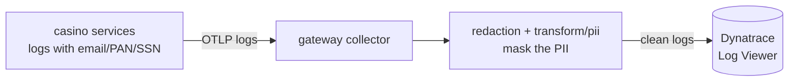

# M7 — Scrubbing PII from logs

_The `labs/advanced/` directories keep their original feature-ordinal numbering, so they run one behind these doc modules — this page's assets live under `labs/advanced/step5-pii-redaction/`._

**Goal:** stop shipping player PII to Dynatrace. You will fix the planted leak
at the **source (SDK)** — the frontend's verbose audit logging — and backstop
it at the **collector**, where regex masking covers email, credit-card PAN, and
SSN in log bodies. When hand-rolled regex stops scaling, the fleet answer is
centrally managed redaction over OpAMP/BindPlane (appendix). Budget 40 minutes.

## The concept

The casino logs player email, client IP, credit-card PAN, and SSN. Shipping that
to a shared observability backend is a compliance incident (GDPR and friends)
and a trust problem: everyone with tenant log access just became a data handler.
Clean it at the source first; enforce it at the collector so policy holds no
matter what any workload ships.



## ① Find it — the email in the log

Register/login as your player at http://localhost:30000 (the UI from M0), then
in Dynatrace open **Logs** and filter `service.name = vegas-frontend-service`,
search for `login_audit`.

**What you should see:** a structured log entry per login containing — in plain
text — the player's **email address**, **client IP**, and **user agent**. Other
services log worse: a player-service line like
`charged player john.doe@example.com card 4111 1111 1111 1111 ssn 123-45-6789`
lands in the Log Viewer with the PII intact.

??? question "Where does it come from? (click after the hunt)"
    Another "request from a team" — compliance sign-off wanted verbose audit
    logging — wired as an env var in `50-frontend.yaml`:

    ```yaml
    # Verbose audit logging for compliance sign-off
    - name: AUDIT_LOG_VERBOSITY
      value: "verbose"
    ```

    In verbose mode the frontend's `login_audit` logs raw values. The app
    ships redaction helpers (`services/common/pii.js`: masked email, hashed
    IP, masked username) that are used automatically in every *other* mode.

## ② Fix it at the source (SDK) — opencode → PR/MR on your git host

Same loop as M1/M2/M6 — drive opencode, review, ship through your git host
(GitLab fork default, Gitea fallback) because the casino namespace is
GitOps-owned:

```bash
opencode run "Using the otel-instrumentation skill: in k8s/50-frontend.yaml, the \
vegas-casino-frontend container sets AUDIT_LOG_VERBOSITY to 'verbose', which logs \
raw player email, client IP, and user agent in login_audit lines. Set it to \
'redacted' so the built-in redaction helpers mask the PII. Change nothing else."
```

Read the one-line diff (`value: "verbose"` → `value: "redacted"`), ship it, and
merge the PR/MR (Gitea fallback: `gitea-pr.sh "fix(frontend): redact PII in
login_audit logs"`). Argo CD rolls the frontend; log in again.

!!! warning "If the agent gets it wrong — steer it back"
    *"the only value to change is AUDIT_LOG_VERBOSITY, set it to `redacted` (not
    `off` — we keep the audit trail, just masked)."*

**What you should see:** emails masked (`j****@…`), IPs hashed to a short hex
digest, usernames partially masked. The audit event survives — you kept the
audit trail and dropped the liability.

## ③ Backstop it at the collector

A transform/redaction on the **logs** pipeline scrubs even what a workload
ships raw. Body fields are strings, so collector-side regex scrubbing of the
body is possible but brittle; attribute-level scrubbing is robust. At fleet
scale this backstop is what makes PII policy enforceable in one place.

Drive `opencode` at the gateway with the `otel-collector` + `otel-ottl` skills —
masking log PII is a transform, so name OTTL explicitly:

```bash
opencode run "Using the otel-collector and otel-ottl skills: in \
observability/collectors/gateway.yaml add redaction for player PII in LOG bodies — \
mask email, credit-card PAN, and SSN patterns (a transform/pii processor with \
OTTL replace_pattern on log.body, plus the redaction processor). Wire it into the \
logs pipeline only, after k8sattributes and before the exporter. Keep memory_limiter \
first and do not add a batch processor."
```

Confirm the masking is on the **logs** pipeline, covers email/PAN/SSN, and sits
after `k8sattributes`. Reference answer:
`labs/advanced/step5-pii-redaction/redaction-processor.yaml`.

!!! warning "If the agent gets it wrong — steer it back"
    If it leaves one PII shape unmasked or masks trace attributes instead of log
    bodies, reply *"mask all three — email, PAN, SSN — on log.body in the logs
    pipeline only."* Always re-run the leak-scan DQL to confirm `leaks == 0`.

Review the diff, then apply (collector — `kubectl apply`, not the git loop; see
[M5](../module-3.md)):

```bash
bash observability/validate.sh
kubectl apply -f observability/collectors/gateway.yaml
kubectl -n observability rollout status deploy/otel-gateway-collector
```

The same line now arrives as:

```
charged player ***EMAIL_REDACTED*** card ***PAN_REDACTED*** ssn ***SSN_REDACTED***
```

## Dynatrace validation checkpoint

PII leak scan over the last hour — expect **zero** rows after the fix, in a
Grail Notebook:

```dql
fetch logs, from: now() - 1h
| filter k8s.cluster.name == "<PARTICIPANT_ID>"
| filter matchesValue(content, "*@*.*") or matchesValue(content, "*-**-****")
| summarize leaks = count()
```

- **Before:** `leaks > 0` — raw email/PAN/SSN visible in the Log Viewer.
- **After (source fix + redaction):** `leaks == 0`; sampled `login_audit` lines
  show masked email / hashed IP.

## Escalate — when hand-rolled regex stops scaling

The collector redaction above already satisfies the Definition of done. But
regex-by-hand does not scale: new PII shapes, per-service rules, and an audit
trail each mean more YAML edited per collector. The fleet answer is to author the
config **once** in **BindPlane OP** and push it to the collectors over OpAMP —
via the OTel Operator's **OpAMP bridge**, optionally through an **OpAMP gateway
(relay)** for segmented clusters.

That full deploy-and-connect walkthrough — BindPlane install, the relay, the
bridge CRD, and the central *Mask Sensitive Data* push — lives in the
[OpAMP/BindPlane appendix](bindplane-opamp.md) (optional / stretch), and the
hands-on fleet exercise is [M10](../module-5.md).

!!! tip "Dig deeper"
    [B5 — Structure unstructured logs (OTTL)](catalog-b5-ottl-log-structuring.md)
    parses opaque casino lines into typed `casino.*` attributes;
    [A2 — Log ↔ trace correlation](catalog-a2-log-trace-correlation.md) links
    each log line to its span.

## Definition of done

- [ ] Raw PII confirmed in the Log Viewer before the fix (login_audit email/IP,
      PAN/SSN lines)
- [ ] Source fix driven with opencode and shipped as a **merged PR/MR**
      (`AUDIT_LOG_VERBOSITY=redacted`) and verified masked in Dynatrace
- [ ] `redaction` + `transform/pii` wired into the logs pipeline (opencode +
      `kubectl apply`), covering email / PAN / SSN on `log.body`
- [ ] The leak-scan DQL returns `leaks == 0`
- [ ] _(Stretch)_ Central config pushed via the [BindPlane appendix](bindplane-opamp.md)

Next: [M8 — The cost of observability](step-4-cost-of-observability.md).

!!! break "☕ Break — 15 minutes"
    You have finished the second segment (M4–M7: collector & governance).
    Stretch, refill, back in 15 — when you come back, pick up at
    [M8 — The cost of observability](step-4-cost-of-observability.md).
