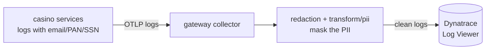
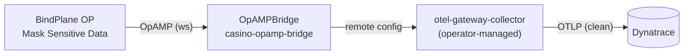

# Step 6 — PII in logs

_The `labs/advanced/` directories keep their original feature-ordinal numbering, so they run one behind these doc steps — this page's assets live under `labs/advanced/step5-pii-redaction/`._

**Goal:** stop shipping player PII to Dynatrace. You will redact it at the
collector first, then escalate to centrally managed redaction with BindPlane OP
over the OTel Operator's OpAMP bridge when hand-rolled regex stops scaling.
Budget 30 minutes.

## The concept

The casino logs player email, credit-card PAN, and SSN. Shipping that to
Dynatrace is a compliance incident. Clean it at the collector (regex) first, then
hand the config to BindPlane when per-service rules and audit requirements
outgrow hand-maintained YAML.



## Before — raw PII in the Log Viewer

The baseline gateway exports logs verbatim. A player-service line like:

```
charged player john.doe@example.com card 4111 1111 1111 1111 ssn 123-45-6789
```

lands in the Dynatrace Log Viewer **with the PII intact**.

## ② Opencode — redact at the collector

Drive `opencode` at the gateway with the `otel-collector` + `otel-ottl` skills —
masking log PII is a transform, so name OTTL explicitly:

```bash
opencode run "Using the otel-collector and otel-ottl skills: in \
observability/collectors/gateway.yaml add redaction for player PII in LOG bodies — \
mask email, credit-card PAN, and SSN patterns (a transform/pii processor with \
OTTL replace_pattern on log.body, plus the redaction processor). Wire it into the \
logs pipeline only, after k8sattributes and before batch. Keep memory_limiter \
first and batch last."
```

## ③ Review — read the diff

Confirm the masking is on the **logs** pipeline, covers email/PAN/SSN, and sits
between `k8sattributes` and `batch`. Reference answer:
`labs/advanced/step5-pii-redaction/redaction-processor.yaml`.

!!! warning "If the agent gets it wrong — steer it back"
    If it leaves one PII shape unmasked or masks trace attributes instead of log
    bodies, reply *"mask all three — email, PAN, SSN — on log.body in the logs
    pipeline only."* Always re-run the leak-scan DQL to confirm `leaks == 0`.

## ④ Apply — kubectl

```bash
kubectl apply -f observability/collectors/gateway.yaml
```

The same line now arrives as:

```
charged player ***EMAIL_REDACTED*** card ***PAN_REDACTED*** ssn ***SSN_REDACTED***
```

## Escalate — BindPlane OP via the OpAMP bridge (optional / stretch)

!!! info "Optional / stretch"
    The collector redaction above already satisfies the Definition of done. This
    BindPlane escalation is a stretch exercise for cohorts with time — skip it to
    go straight to [Step 7](step-7-tail-sampling.md).

When regex-by-hand no longer scales (new PII shapes, per-service rules, audit
trail), hand config to **BindPlane OP** over OpAMP. The OTel Operator's OpAMP
bridge connects the operator-managed collectors to BindPlane, so redaction config
is authored and pushed centrally instead of edited in YAML per collector.



```bash
# 1. BindPlane OP server in-cluster (pin the chart version for the training).
helm repo add bindplane https://observiq.github.io/bindplane-op-helm
helm upgrade --install bindplane bindplane/bindplane -n observability --create-namespace

# 2. Connection token for the bridge (BindPlane → Settings → OpAMP / install command).
kubectl -n observability create secret generic bindplane-opamp \
  --from-literal=BINDPLANE_OPAMP_TOKEN='<token-from-bindplane>'
kubectl -n observability set env opampbridge/casino-opamp-bridge --from=secret/bindplane-opamp

# 3. The OpAMP bridge.
kubectl apply -f labs/advanced/step5-pii-redaction/bindplane-opamp/opampbridge.yaml
```

In BindPlane, attach a **Mask Sensitive Data** processor to the casino log source
and push — the bridge delivers it to `otel-gateway-collector` with no manual YAML.

!!! note "Gotchas"
    - The bridge image tag (`operator-opamp-bridge:0.162.0`) tracks the operator
      release line — keep it consistent with `OTEL_OPERATOR_VERSION` in
      `observability/versions.env` (currently `v0.162.0`; the bridge image omits
      the leading `v`).
    - `componentsAllowed` is an allow-list: BindPlane cannot push a component the
      bridge does not permit — a safety rail for the training cluster.
    - This **supersedes** the hand-rolled `redaction`/`transform/pii` once
      BindPlane owns the config; keep the Step 5 processors as the "before
      BindPlane" baseline.

## Dynatrace validation checkpoint

PII leak scan over the last hour — expect **zero** rows after the fix, in a Grail
Notebook:

```dql
fetch logs, from: now() - 1h
| filter k8s.namespace.name == "casino"
| filter matchesValue(content, "*@*.*") or matchesValue(content, "*-**-****")
| summarize leaks = count()
```

- **Before:** `leaks > 0` — raw email/PAN/SSN visible in the Log Viewer.
- **After (redaction):** `leaks == 0`; sampled lines show `***…_REDACTED***`.
- **After (BindPlane):** same clean result, now driven by the pushed BindPlane
  config; the OpAMPBridge reports **healthy + effective-config** in Dynatrace.

## Definition of done

- [ ] Raw email/PAN/SSN confirmed in the Log Viewer before the fix
- [ ] `redaction` + `transform/pii` wired into the logs pipeline
- [ ] The leak-scan DQL returns `leaks == 0`
- [ ] BindPlane OP + OpAMP bridge deployed; a Mask Sensitive Data config pushed
- [ ] The OpAMPBridge reports healthy + effective-config

Next: [Step 7 — Tail sampling](step-7-tail-sampling.md).
