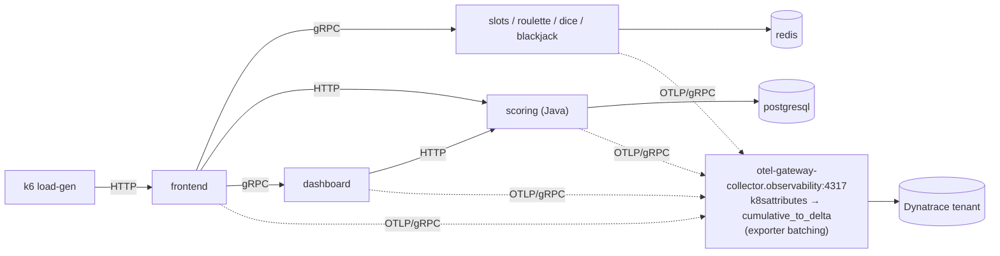

# Beyond the Honeymoon: OTel in Practice

Welcome to the Perform hands-on training. The Vegas Casino application you are
running today ships with deliberately broken observability. This is **one
single training guide** — a continuous module arc M0–M10 with two 15-minute
breaks — that takes the casino from broken traces to a production-grade
OpenTelemetry pipeline: SDK first, collector second, fleet management last.
Every fix lands in Dynatrace, and every fix is produced by the `opencode` AI
agent, not hand-written.

## The honeymoon problem

Every OpenTelemetry rollout follows the same curve. The honeymoon: a quickstart
gets traces flowing, dashboards light up, everyone is happy. Then reality
arrives — a service drops off the trace, a metric dimension explodes into
millions of series, an email address shows up in a log — and nobody knows which
config surface fixes it, because the config was never really *owned*. It was
copied.

Today you take ownership. The casino has real defects, planted on purpose. You
diagnose them in Dynatrace, fix them in configuration — never in application
code — and verify each fix in the tenant. And you do not hand-write the fixes:
the `opencode` AI agent produces them, you review the diff, land it (Git host
PR for app manifests, `kubectl apply` for the collector), and verify with DQL —
the **Problem → Opencode → Review → Apply → Verify** loop, introduced in
[M0](setup.md) and used by every module.

## What you will build

One continuous arc, M0–M10, split into three segments by two 15-minute breaks
(also marked inline at the end of M3 and M7):

| Time | Module | You will… |
|---|---|---|
| 0:00–0:20 | [M0 — Environment setup](setup.md) | Fork the casino on GitLab (Gitea fallback), Codespace up, cluster healthy, Dynatrace connected, `opencode` + skills installed, casino deployed |
| 0:20–0:50 | [M1 — Tour the broken casino](module-1.md) | Warm up the agent; diagnose the trace-context defect; fix W3C propagation via opencode + a PR |
| 0:50–1:20 | [M2 — Instrument the casino](module-2.md) | Declarative `otel-config.yaml` for the Java service **and** AI-agent money-path spans on slots |
| 1:20–1:45 | [M3 — Business metrics](advanced/step-2-business-metrics.md) | Counter + histogram on the money-path; a live "bets by outcome" dashboard tile |
| 1:45–2:00 | **☕ Break — 15 minutes** | |
| 2:00–2:25 | [M4 — Semantic conventions with Weaver](advanced/step-3-weaver-pipeline.md) | Versioned `casino.*` registry; watch CI go red on a rename or a high-cardinality dimension |
| 2:25–3:05 | [M5 — The collector as control point](module-3.md) | Read the gateway pipeline; the three invariants that never change |
| 3:05–3:30 | [M6 — Taming high-cardinality metrics](advanced/step-5-high-cardinality.md) | Find the unbounded dimension; fix at the SDK, backstop at the collector |
| 3:30–3:55 | [M7 — Scrubbing PII from logs](advanced/step-6-pii-logs.md) | Redact email/PAN/SSN at the source and at the collector; leak-scan DQL returns zero |
| 3:55–4:10 | **☕ Break — 15 minutes** | |
| 4:10–4:30 | [M8 — The cost of observability](advanced/step-4-cost-of-observability.md) | Stamp `dt.cost.costcenter` at the gateway; read the ingest split per cost center |
| 4:30–5:05 | [M9 — Sampling strategy](module-4.md) | Break naive head sampling, then tail-sample smart (errors/slow/jackpot kept) + spanmetrics |
| 5:05–5:40 | [M10 — Operating at scale + OpAMP/BindPlane](module-5.md) | OpAMP bridge to BindPlane; change the pipeline centrally; readiness checklist |

Want more depth on any topic? The optional
[extra exercises (catalog)](advanced/catalog.md) — themes A (traces), B
(collector), C (Dynatrace automation), D (capstone) — hang off the same arc,
cross-linked from the modules above.

## The environment

Everything runs in **your GitHub Codespace** — nothing is installed on your
laptop but a browser:

- **kind cluster** in your Codespace, one per attendee
- **Vegas Casino** — Node.js, Python, Go and Java microservices (namespace `casino`)
- **OTel collectors** — a DaemonSet for node logs and a gateway collector that
  enriches and exports to Dynatrace (namespace `observability`)
- **Dynatrace** — shared tenant; your cluster is identified by your unique
  `K8S_CLUSTER_NAME`
- **GitOps** — your **GitLab fork** of the casino project (the in-cluster
  **Gitea** is the documented offline fallback) and Argo CD sync the `casino`
  namespace. You fix defects by editing a manifest and committing — the same
  loop you would use in production

## How to use this guide

- **Command blocks** are meant to be pasted into the Codespace terminal —
  including the `opencode run "..."` prompts, which name the goal, the target
  file, and the skill the agent should use.
- **Dynatrace check** sections tell you exactly what to look for in the tenant.
  A fix that does not show up in Dynatrace did not happen.
- Each module ends with a **Definition of done**. A helper will check you off
  before you move on.
- Solutions for each defect hunt are collapsed — try the hunt first, then
  click to reveal.
- If the agent's diff is wrong, **steer it back with a one-line correction**
  instead of hand-editing — every module has an "if the agent gets it wrong"
  note.

**Start here:** open [M0 — Environment Setup](setup.md).
