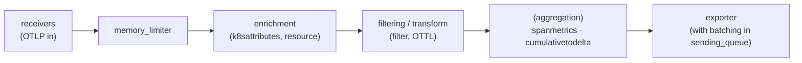

# M5 — The collector as control point

**Goal:** learn the collector pipeline — the one control point between every
workload and Dynatrace — and its three invariants. Then apply it in the next
modules: high-cardinality and PII fixes (M6–M7), cost (M8), sampling (M9).
40 minutes.

## Concepts (5 min)

A collector pipeline is `receivers → processors → exporters`, per signal
(traces / metrics / logs). The canonical processor order:



Why this order, one sentence each:

- `memory_limiter` **first** — shed load before spending memory on it.
- **Enrichment before filtering** — you cannot filter on an attribute you have
  not added yet.
- **Batch in the exporter, not in a processor** — the `batch` processor is deprecated; batching
  now happens once, after all mutation, inside the exporter's `sending_queue` (see the note below).

!!! note "Why there is no `batch` processor"
    The Collector's `batch` processor is **deprecated** and is planned for removal from the core
    distributions in `v0.177.0` (May 2027); exporter-level batching becomes the default in
    `v0.171.0` (February 2027). Batching now lives in the exporter's `sending_queue`:

    ```yaml
    exporters:
      otlp_http/dynatrace:
        sending_queue:
          enabled: true
          sizer: items
          queue_size: 10000      # holds small, UNBATCHED requests — size it generously
          batch:
            enabled: true
            sizer: items
            min_size: 512        # was batch processor `send_batch_size`
            max_size: 1024       # was `send_batch_max_size`
            flush_timeout: 5s    # was `timeout`
    ```

    Migration is mechanical: delete `batch` from `processors:` and from every pipeline,
    then enable `sending_queue.batch`. After migrating, compare
    `otelcol_exporter_queue_size` with `otelcol_exporter_queue_capacity` — the queue
    now holds unbatched requests, so the old `queue_size` can overflow sooner. If you
    genuinely need batching *between* processors (e.g. before an aggregation processor),
    the `queue_batch` processor takes the same settings. Do not run both a `batch`
    processor and `sending_queue.batch`. Details:
    [Migrating from the batch processor](https://opentelemetry.io/blog/2026/collector-batching-migration/).

    This is a **Collector** change only. The SDK `batch` span/log processors used in
    M2's `otel-config.yaml` are unaffected.

And the thesis of this module: **the collector is a control point**. It sits
between every workload and the backend, so it is the one place you can enforce
policy — cardinality limits, PII scrubbing, routing, sampling — even when an
individual SDK misbehaves. But the control point only sees what reaches it:
the cheapest fixes are still at the source, which is why the defects in M6 and
M7 each get fixed twice — at the SDK, then backstopped at the collector.

## Tour — your collector, the reference pipeline

The gateway collector runs as an `OpenTelemetryCollector` CR in your repo.
Open it in your Codespace editor:

```bash
code observability/collectors/gateway.yaml   # or just open the file
```

Find the `config:` block and read the pipelines. This one is the **reference
answer** for processor order:

- `memory_limiter` first, on every pipeline
- `k8sattributes` — enrichment: attaches `k8s.pod.name`, `k8s.namespace.name`,
  and friends (it can do this because the DaemonSet forwards pod metadata and
  the gateway runs in-cluster)
- `cumulative_to_delta` — **metrics pipeline only**: counters arrive cumulative,
  Dynatrace wants rates
- **no `batch` processor** — batching is configured on the `otlp_http` exporter
  (`sending_queue.batch`), which exports to your Dynatrace tenant

You will edit this file in the exercises that follow (M6–M9). The discipline
around it is **config-as-product**: edit in Git → validate offline → apply →
verify. Never `kubectl edit` a live collector.

!!! note "Collector fixes apply differently — `kubectl apply`, not the git PR loop"
    The gateway collector (`observability/collectors/gateway.yaml`) lives in the
    **training repo** and runs in the `observability` namespace, which Argo CD
    does **not** manage — so collector changes are applied with `kubectl apply`,
    not the git-host PR loop. opencode still drives the edit; only the apply step
    differs. App-code fixes (M1, M2, and the SDK halves of M6/M7) ship through
    your git host (GitLab fork default, Gitea fallback) → merge → Argo CD sync —
    see [M0 §3–§4](setup.md).

## Where the control point gets used next

- **[M6 — Taming high-cardinality metrics](advanced/step-5-high-cardinality.md)** —
  drop the unbounded `player_id` / `round.id` dimensions at the gateway.
- **[M7 — Scrubbing PII from logs](advanced/step-6-pii-logs.md)** —
  redact email / PAN / SSN on the logs pipeline.
- **[M8 — The cost of observability](advanced/step-4-cost-of-observability.md)** —
  stamp `dt.cost.costcenter` on all three signals.
- **[M9 — Sampling strategy](module-4.md)** — tail sampling + spanmetrics on the
  traces pipeline.

At fleet scale this manual discipline gets a product around it: **OpAMP** +
**BindPlane** central config — see [M10](module-5.md) and the
[OpAMP/BindPlane appendix](advanced/bindplane-opamp.md).

## Definition of done — M5

- [ ] You can recite the canonical processor order and defend each position
- [ ] You can state the three invariants (`memory_limiter` first, no `batch`
      processor, enrichment before filtering) and why the exporter's
      `sending_queue.batch` replaced the deprecated processor
- [ ] You can say, in one sentence, why the collector is the right place for a
      policy backstop — and why the source fix still comes first
- [ ] You know which apply mechanic each surface needs: git PR/MR for
      GitOps-owned app manifests, `kubectl apply` for the collector

Next: [M6 — Taming high-cardinality metrics](advanced/step-5-high-cardinality.md).

