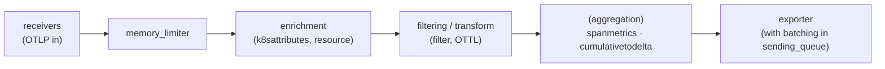

# M3 — The collector as control point

**Goal:** learn the collector pipeline, then fix two more planted defects — a
high-cardinality metric and PII in logs — at the SDK **and** defend them at the
collector. 40 minutes. This is the centerpiece module.

## Concepts (5 min)

A collector pipeline is `receivers → processors → exporters`, per signal
(traces / metrics / logs). The canonical processor order:



Why this order, one sentence each:

- `memory_limiter` **first** — shed load before spending memory on it.
- **Enrichment before filtering** — you cannot filter on an attribute you have
  not added yet.
- **Batch in the exporter, not in a processor** — the `batch` processor is deprecated; batching
  now happens once, after all mutation, inside the exporter's `sending_queue` (see the note below).

!!! note "Why there is no `batch` processor"
    The Collector's `batch` processor is **deprecated** and is planned for removal from the core
    distributions in `v0.177.0` (May 2027); exporter-level batching becomes the default in
    `v0.171.0` (February 2027). Batching now lives in the exporter's `sending_queue`:

    ```yaml
    exporters:
      otlp_http/dynatrace:
        sending_queue:
          enabled: true
          sizer: items
          queue_size: 10000      # holds small, UNBATCHED requests — size it generously
          batch:
            enabled: true
            sizer: items
            min_size: 512        # was batch processor `send_batch_size`
            max_size: 1024       # was `send_batch_max_size`
            flush_timeout: 5s    # was `timeout`
    ```

    Migration is mechanical: delete `batch` from `processors:` and from every pipeline,
    then enable `sending_queue.batch`. After migrating, compare
    `otelcol_exporter_queue_size` with `otelcol_exporter_queue_capacity` — the queue
    now holds unbatched requests, so the old `queue_size` can overflow sooner. If you
    genuinely need batching *between* processors (e.g. before an aggregation processor),
    the `queue_batch` processor takes the same settings. Do not run both a `batch`
    processor and `sending_queue.batch`. Details:
    [Migrating from the batch processor](https://opentelemetry.io/blog/2026/collector-batching-migration/).

    This is a **Collector** change only. The SDK `batch` span/log processors used in
    Module 2's `otel-config.yaml` are unaffected.

And the thesis of this module: **the collector is a control point**. It sits
between every workload and the backend, so it is the one place you can enforce
policy — cardinality limits, PII scrubbing, routing, sampling — even when an
individual SDK misbehaves. But the control point only sees what reaches it:
the cheapest fixes are still at the source, which is why every defect below
gets fixed twice — at the SDK, then backstopped at the collector.

## Tour — your collector, the reference pipeline

The gateway collector runs as an `OpenTelemetryCollector` CR in your repo.
Open it in your Codespace editor:

```bash
code observability/collectors/gateway.yaml   # or just open the file
```

Find the `config:` block and read the pipelines. This one is the **reference
answer** for processor order:

- `memory_limiter` first, on every pipeline
- `k8sattributes` — enrichment: attaches `k8s.pod.name`, `k8s.namespace.name`,
  and friends (it can do this because the DaemonSet forwards pod metadata and
  the gateway runs in-cluster)
- `cumulative_to_delta` — **metrics pipeline only**: counters arrive cumulative,
  Dynatrace wants rates
- **no `batch` processor** — batching is configured on the `otlp_http` exporter
  (`sending_queue.batch`), which exports to your Dynatrace tenant

You will edit this file in the exercises. The discipline around it is
**config-as-product**: edit in Git → validate offline → apply → verify. Never
`kubectl edit` a live collector.

## Exercise A — the metric that ate the tenant (high cardinality)

### Find it

The k6 load generator plays constantly with generated usernames
(`k6user_<timestamp>_<random>`). Look at what that does to one metric.

In Dynatrace, open **Metrics** and search for `casino.bet.amount`. This is a
histogram — amount wagered per game round, USD — recorded by the frontend with
a `game` dimension. Sensible.

Now inspect its dimensions: filter or split by **`player_id`**.

**What you should see:** `player_id` exists and has a value per player — and
every k6 round mints a *new* player. A histogram's series count is
`dimensions × buckets`: unbounded `player_id` means unbounded time series.
Run the load for an hour and this one metric generates more series than the
rest of the casino combined. Cardinality is the tax you pay *before* you see
any bill — it degrades queries and dashboards first, ingest cost second.

??? question "Where does player_id come from? (click after the hunt)"
    The frontend deployment asks for it — a "per-player breakdown requested by
    analytics" — via an env var in `50-frontend.yaml`:

    ```yaml
    # Per-player metric breakdown requested by the analytics team
    - name: CASINO_PLAYER_LEVEL_METRICS
      value: "true"
    ```

    With it, `services/common/casino-metrics.js` adds `attributes.player_id =
    username` to every bet recording. The ask was reasonable; the dimension
    key was unbounded.

### Fix it at the source (SDK) — opencode → Gitea PR

Same loop as M1/M2: drive **opencode**, review the diff, ship it as a **Gitea PR**
that Argo CD syncs. (If you have not cloned the casino repo for opencode yet, run
the [one-time setup from M1](module-1.md#the-fix-drive-it-with-opencode-ship-it-through-gitea).)

```bash
opencode run "Using the otel-instrumentation skill: in k8s/50-frontend.yaml, the \
vegas-casino-frontend container sets CASINO_PLAYER_LEVEL_METRICS to 'true', which \
adds an unbounded player_id dimension to casino.bet.amount. Set it to 'false'. \
Change nothing else."
```

Read the one-line diff (`value: "true"` → `value: "false"`), then ship it:

```bash
gitea-pr.sh "fix(frontend): drop unbounded player_id metric dimension"
```

**Review and merge the PR in the Gitea UI**
(`http://localhost:30001/casino/casino/pulls`); Argo CD rolls the frontend (hit
**Refresh** at `http://localhost:30002`):

```bash
kubectl -n casino rollout status deploy/vegas-casino-frontend
```

!!! warning "If the agent gets it wrong — steer it back"
    - **Flipped the wrong knob** (touched `AUDIT_LOG_VERBOSITY`): *"the only
      value to change is CASINO_PLAYER_LEVEL_METRICS, set it to false."*
    - **Deleted the env var** instead of setting it false: *"keep the env var,
      just change its value to false."*

### Backstop it at the collector (control point)

The SDK fix only holds while every deployment keeps that knob `false`. A
control point makes the policy structural: the gateway drops the dimension
no matter what workloads send.

!!! note "Collector fixes apply differently — `kubectl apply`, not the Gitea PR"
    The gateway collector (`observability/collectors/gateway.yaml`) lives in the
    **training repo** and runs in the `observability` namespace, which Argo CD
    does **not** manage — so collector changes are applied with `kubectl apply`,
    not the casino git loop. opencode still drives the edit; only the apply step
    differs. (This is the same app-code-vs-collector split the advanced track
    spells out in [The environment](advanced/environment.md#the-agent-loop-problem-opencode-verify).)

Drive the edit with opencode, pointed at the collector file and the OTTL skill:

```bash
opencode run "Using the otel-ottl skill: in observability/collectors/ \
gateway.yaml, add a transform processor 'transform/drop_player_id' \
(error_mode: ignore) that runs delete_key(attributes, \"player_id\") on each \
metric datapoint, and reference it in the metrics pipeline after k8sattributes \
and before cumulative_to_delta. Keep memory_limiter first and do not add a \
batch processor."
```

The target shape — a transform processor:

```yaml
    processors:
      transform/drop_player_id:
        error_mode: ignore
        metric_statements:
          - context: datapoint
            statements:
              - delete_key(attributes, "player_id")
```

referenced in the **metrics** pipeline, after enrichment and before the exporter:

```yaml
    service:
      pipelines:
        metrics:
          receivers: [otlp]
          processors: [memory_limiter, k8sattributes, transform/drop_player_id, cumulative_to_delta]
          exporters: [otlp_http/dynatrace]
```

*(Keep the processor list already present in your file; the point is where the
new one sits.)*

!!! warning "If the agent gets it wrong — steer it back"
    *"memory_limiter must stay the first processor, there must be no batch
    processor, and transform/drop_player_id goes on the metrics pipeline only —
    between k8sattributes and cumulative_to_delta."*

Review the diff, then apply the config-as-product discipline:

```bash
bash observability/validate.sh
kubectl apply -f observability/collectors/gateway.yaml
kubectl -n observability rollout status deploy/otel-gateway-collector
```

### Dynatrace check

1. Play a few rounds (or wait for k6), then re-check `casino.bet.amount`:
   new datapoints no longer carry `player_id`; existing split-by-player
   results stop gaining new series.
2. The `game` dimension survives — you lost nothing you actually chart.

## Exercise B — the email in the log (PII)

### Find it

Register/login as your player at http://localhost:30000 — the UI you used in
M0 — then in Dynatrace open **Logs** and filter `service.name =
vegas-frontend-service`, search for `login_audit`.

**What you should see:** a structured log entry per login, containing — in
plain text — the player's **email address**, **client IP**, and **user
agent**. Player-tracking data in a shared observability backend is a
compliance problem (GDPR and friends), and a trust problem: everyone with
tenant log access just became a data handler.

??? question "Where does it come from? (click after the hunt)"
    Another "request from a team" — compliance sign-off wanted verbose audit
    logging — wired as an env var in `50-frontend.yaml`:

    ```yaml
    # Verbose audit logging for compliance sign-off
    - name: AUDIT_LOG_VERBOSITY
      value: "verbose"
    ```

    In verbose mode the frontend's `login_audit` logs raw values. The app
    ships redaction helpers (`services/common/pii.js`: masked email, hashed
    IP, masked username) that are used automatically in every *other* mode.

### Fix it at the source (SDK) — opencode → Gitea PR

Same loop again — drive opencode, review, ship a Gitea PR:

```bash
opencode run "Using the otel-instrumentation skill: in k8s/50-frontend.yaml, the \
vegas-casino-frontend container sets AUDIT_LOG_VERBOSITY to 'verbose', which logs \
raw player email, client IP, and user agent in login_audit lines. Set it to \
'redacted' so the built-in redaction helpers mask the PII. Change nothing else."
```

Read the one-line diff (`value: "verbose"` → `value: "redacted"`), ship it, and
merge the PR:

```bash
gitea-pr.sh "fix(frontend): redact PII in login_audit logs"
```

Argo CD rolls the frontend; log in again and re-check the `login_audit` entries.

!!! warning "If the agent gets it wrong — steer it back"
    *"the only value to change is AUDIT_LOG_VERBOSITY, set it to `redacted` (not
    `off` — we keep the audit trail, just masked)."*

**What you should see:** emails masked (`j****@…`), IPs hashed to a short
hex digest, usernames partially masked. The audit event survives — you kept
the audit trail and dropped the liability.

### Backstop it at the collector (stretch)

Same pattern as Exercise A, now for logs. A transform on the logs pipeline
can scrub attributes or body fields even if a workload ships raw values —
with one caveat: body fields are strings, so a collector-side regex scrub of
the body is possible but brittle; attribute-level scrubbing is robust. When
you run collectors as the enforcement point at fleet scale, this backstop is
what makes PII policy enforceable in one place. If you have time, drive opencode
with the `otel-ottl` skill to add a `delete_key(attributes, "user.email")`
transform on the **logs** pipeline of `observability/collectors/gateway.yaml`,
then `validate.sh` + `kubectl apply` it exactly as in Exercise A (collector, so
`kubectl apply` — not the Gitea PR loop).

## The fleet-scale version of what you just did

You enforced policy by editing Git, validating, applying — the honest,
small-fleet workflow. At dozens of clusters and hundreds of collectors, that
workflow gets a product around it: **OpAMP** (the remote-management protocol
for OTel collectors) and managed-configuration platforms such as **BindPlane**
— configuration as a versioned artifact, validated, rolled out **staged**
(canary first), with history and one-click rollback, instead of N repos to
herd. Same discipline you practiced here; the tooling scales it.

## Definition of done — M3

- [ ] You can recite the canonical processor order and defend each position
- [ ] You found `player_id` on `casino.bet.amount` and explained why unbounded
      dimensions are dangerous
- [ ] Source fix driven with opencode and shipped as a **merged Gitea PR**
      (`CASINO_PLAYER_LEVEL_METRICS=false`) and verified
- [ ] Collector backstop for `player_id` driven with opencode, then
      `validate.sh` + `kubectl apply` (collector, not the Gitea loop)
- [ ] You found raw PII in `login_audit` logs, fixed the verbosity knob via an
      opencode-driven Gitea PR, and verified redaction in Dynatrace
- [ ] You can say, in one sentence, why the collector is the right place for
      a policy backstop — and why the source fix still comes first

Next: [M4 — Sampling: cost/fidelity strategy](module-4.md).
